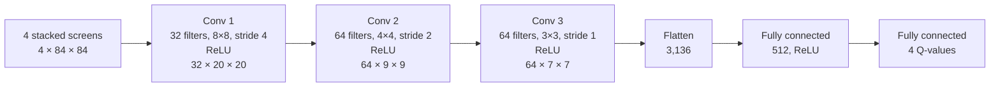
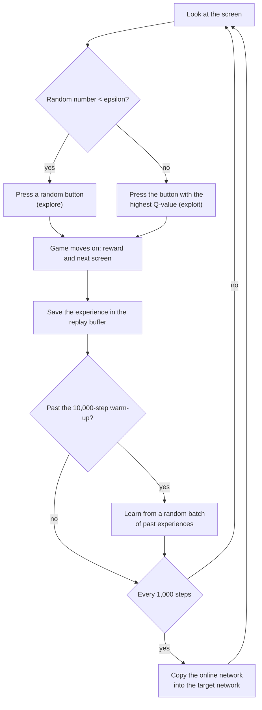
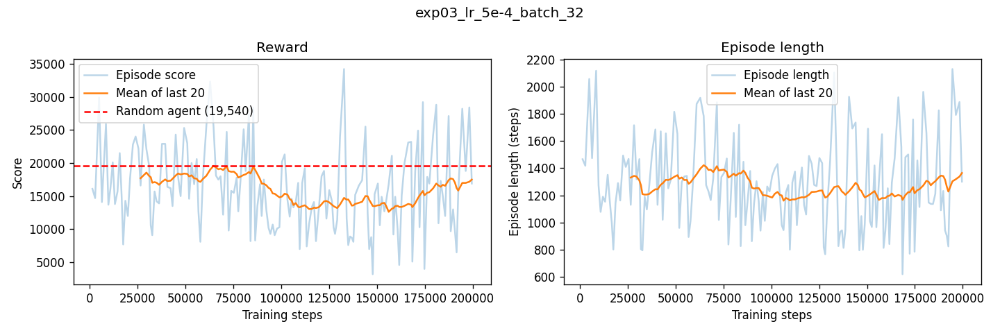
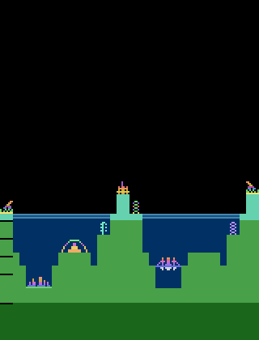

# DQN on Atari Atlantis

## Project introduction

We built a Deep Q-Network (DQN) agent from scratch with PyTorch and Gymnasium, and trained it to play the Atari game Atlantis. No ready-made reinforcement learning library is used (no Stable-Baselines3, RLlib, CleanRL or TorchRL): the network, the replay buffer, the training loop and the learning step are all written in this repository.

Each of us ran 10 experiments, each changing different settings, to see how they affect learning. Our best model beat a random player in all 10 of its test games.

## Group members

| Member | Main contribution |
| --- | --- |
| Sheilla Keza Ruvugabigwi | Game environment, CNN and replay buffer (`notebooks/environment_cnn_buffer.ipynb`, `dqn_components.py`), random-play baseline, 10 learning rate and batch size experiments |
| Jean Muhire | Training loop (`train.py`), training plots (`plot_training.py`), 10 gamma, learning rate and batch size experiments |
| Bianca Haguma | `uv` project setup (`pyproject.toml`, `uv.lock`), run summary in `train.py`, `run_epsilon_experiments.py`, 10 epsilon experiments |
| Together | `play.py`, choosing the final model, this README and the presentation |

The full split of tasks is in `Task allocation sheet.pdf`.

## The game: Atlantis

Environment: `ALE/Atlantis-v5` from the Arcade Learning Environment.

You defend the underwater city of Atlantis. Enemy ships fly across the sky and attack the city's buildings. You control three guns (left, centre and right) and get points for every ship you shoot down. The game ends when all the city's buildings are destroyed.

The agent has 4 buttons:

| Action | What it does |
| --- | --- |
| `NOOP` | Do nothing |
| `FIRE` | Shoot from the centre gun |
| `RIGHTFIRE` | Shoot from the right gun |
| `LEFTFIRE` | Shoot from the left gun |

A player pressing random buttons already scores well in this game: 19,290 on average over 10 games in our notebook. Random games vary a lot (from 13,500 to 31,300 in that test), so we treat about 19,000 as the score a trained agent must beat. The red line in our plots is drawn at 19,540.

## What the agent sees

The raw game screen is 210 × 160 pixels in colour. Before the network sees it, `make_env` in `dqn_components.py`:

1. **Repeats each action for 4 frames** (frame skip), so the agent decides 15 times a second instead of 60.
2. **Turns the screen grey and shrinks it to 84 × 84.** Colour is not needed to play, and a smaller picture trains much faster.
3. **Stacks the last 4 screens together.** One screen cannot show which way a ship is flying; 4 screens in a row can.

So each observation is 4 × 84 × 84 numbers from 0 to 255.

## DQN architecture

The Q-network (`QNetwork` in `dqn_components.py`) is a CNN. It takes the 4 stacked screens and gives back 4 numbers, one Q-value per button: how many points the agent expects if it presses that button now. The agent presses the button with the highest Q-value.



| Layer | Output shape | Weights |
| --- | --- | --- |
| Input (pixels divided by 255) | 4 × 84 × 84 | |
| Conv 1: 32 filters, 8 × 8, stride 4, ReLU | 32 × 20 × 20 | 8,224 |
| Conv 2: 64 filters, 4 × 4, stride 2, ReLU | 64 × 9 × 9 | 32,832 |
| Conv 3: 64 filters, 3 × 3, stride 1, ReLU | 64 × 7 × 7 | 36,928 |
| Fully connected, ReLU | 512 | 1,606,144 |
| Fully connected (output) | 4 | 2,052 |
| **Total** | | **1,686,180** |

The convolution layers slide small filters over the screen, so they find shapes such as ships and guns wherever they are. The fully connected layers turn what was found into the 4 Q-values. The network starts with random weights; no pretrained model is used.

We use two copies of this network:

- The **online network** chooses the moves and learns at every step.
- The **target network** is a copy that is only updated every 1,000 steps. It gives the "right answer" the online network learns towards, and because it changes slowly, those answers stay steady.

## How training works

`train.py` runs this loop for 200,000 steps:



1. **Choose a move (ε-greedy).** With probability ε the agent presses a random button (exploration); otherwise it presses the button with the highest Q-value (exploitation). ε starts at 1.0 (always random) and goes down in a straight line to 0.05 over the first 100,000 steps, so the agent explores first and uses what it learned later.
2. **Play the move** and get the reward and the next screen.
3. **Store the experience** (screen, button, reward, next screen, whether the game ended) in the **replay buffer**, which holds the last 100,000 experiences. The reward is stored as -1, 0 or +1 (reward clipping), so big and small hits teach the same lesson. The real score is kept for the logs.
4. **Learn**, once the buffer has 10,000 experiences: take a random batch of experiences. Random batches matter because screens that follow each other look almost the same.
   - The online network predicts the Q-value of the button that was pressed.
   - The target network gives the target with the **Bellman equation**: `target = reward + gamma × (best Q-value of the next screen) × (1 − done)`. If the game ended (`done = 1`), there is no future, so the target is just the reward.
   - The **loss** is the Huber loss (`smooth_l1_loss`) between the prediction and the target.
   - **Backpropagation** works out how to change each weight, and the **Adam optimizer** makes the change.
5. **Every 1,000 steps**, copy the online network into the target network.
6. **When a game ends**, write one row to `training_log.csv`: game number, game length, total steps, score and epsilon.

At the end, `train.py` saves `dqn_model.pth` (the trained weights) and `summary.json` (the settings and the final score).

### Settings

| Setting | Team baseline | Kept the same in every run? |
| --- | --- | --- |
| Learning rate | 1e-4 | Tested |
| Gamma (how much future rewards count) | 0.99 | Tested |
| Batch size | 32 | Tested |
| Epsilon start, end, decay | 1.0, 0.05, 100,000 steps | Tested |
| Training steps | 200,000 | Yes |
| Seed | 42 | Yes |
| Replay buffer size | 100,000 | Yes |
| Warm-up before learning | 10,000 steps | Yes |
| Learn every | 1 step | Yes |
| Target network update | every 1,000 steps | Yes |
| Longest game allowed | 10,000 steps | Yes |

**Score** in our tables is the mean real game score of the last 20 games of training.

## Experiments

Each member changed different settings and kept all the other settings fixed, so any change in score comes from the settings being tested.

| Member | What was tested | Best run | Score |
| --- | --- | --- | --- |
| Sheilla | Learning rate and batch size (gamma 0.99) | Learning rate 5e-4, batch 128 | 18,695 |
| Jean | Gamma, then learning rate and batch size at gamma 0.95 | Gamma 0.95, batch 64 | 29,245 |
| Bianca | Epsilon start, end and decay | 1.0 to 0.01 over 50,000 steps | 23,580 |

Full tables, with what happened in every run:

- [Sheilla's experiments](hyperparameter_results_table/SheillaRuvugabigwiHyperparameter_experiment_results.md)
- [Jean's experiments](hyperparameter_results_table/JeanMuhireHyperparameter_experiment_results.md)
- [Bianca's experiments](hyperparameter_results_table/BiancaHagumaHyperparameter_experiment_results.md)

Every run's model and full training log are in `models/<member name>/`, and its plots are in `training_plots/<member name>/`.

## The final model

Training scores are measured while the agent still presses 5% random buttons, and only over its last 20 games. The demo plays with no random moves at all. To choose the demo model fairly, we played **10 games with every one of our 30 models, with no random moves**, using the same 10 games for each.

The best was Sheilla's experiment 3 (learning rate 5e-4, batch 32, gamma 0.99): it **beat random play in all 10 games**, with an average of **30,060** (lowest 21,400, highest 46,900). It is the default model in `play.py`:

`models/SheillaRuvugabigwi/exp03_lr_5e-4_batch_32/dqn_model.pth`

Its training performance:

| | |
| --- | --- |
| Training steps | 199,570 (156 games) |
| Average game length | 1,279 steps (1,365 in the last 20 games) |
| Score, mean of the last 20 games | 17,500 |
| Best single game in training | 34,200 |
| Longest game in training | 2,130 steps |



This also showed us that the training score and the no-random-moves score do not always agree. Jean's experiment 9 had the best training score (29,245) but averaged 25,690 with no random moves, while Sheilla's experiment 3 scored 17,500 in training and 30,060 with no random moves.

## Gameplay demonstration

`play.py` loads `dqn_model.pth`, rebuilds the same CNN, puts it in evaluation mode and plays with no random moves: on every screen it presses the button with the highest Q-value. It opens a window and shows the game in real time.

The first 30 seconds of the demo game:



Full game video (2 minutes, final score 36,900): [assets/gameplay.mp4](assets/gameplay.mp4)

## How to run it

The project uses [`uv`](https://docs.astral.sh/uv/). Install everything once:

```bash
uv sync
```

Watch the final model play (press Q to stop):

```bash
uv run python play.py
```

Play several games without a window and print the scores, or try another model:

```bash
uv run python play.py --episodes 5 --no-render
uv run python play.py --model models/JeanMuhire/exp03_gamma_0.97/dqn_model.pth
```

Train a model with your own settings. A GPU is much faster than a CPU: we trained on Colab and Kaggle GPUs.

```bash
uv run python train.py --gamma 0.95 --batch-size 64 --output-dir models/my_run
```

Plot a run, or compare several runs:

```bash
uv run python plot_training.py models/my_run --output my_run.png
uv run python plot_training.py models/run_a models/run_b --output compare.png
```

Run the 10 epsilon experiments in one go:

```bash
uv run python run_epsilon_experiments.py
```

Open the notebook:

```bash
uv run --with jupyter jupyter lab
```

## Files

| File or folder | What it is |
| --- | --- |
| `dqn_components.py` | The game environment (`make_env`), the CNN (`QNetwork`) and the replay buffer (`ReplayBuffer`) |
| `train.py` | Trains one agent and saves `dqn_model.pth`, `training_log.csv` and `summary.json` |
| `play.py` | Loads a trained model and shows it playing |
| `plot_training.py` | Makes training plots from `training_log.csv` |
| `run_epsilon_experiments.py` | Runs the 10 epsilon experiments |
| `notebooks/environment_cnn_buffer.ipynb` | Step-by-step tests of the environment, CNN and replay buffer, and the random-play baseline |
| `models/` | Every trained model and its training log, one folder per member |
| `training_plots/` | Training plots, one folder per member |
| `hyperparameter_results_table/` | Each member's experiment table |
| `assets/` | Gameplay video and GIF |
| `pyproject.toml`, `uv.lock` | The packages the project needs, for `uv` |

## Limits

- Each setting was run once, with one seed, so small differences between runs may be luck.
- 200,000 steps is short for Atari DQN, and many runs ended below random play. With more time we would train longer and repeat the best settings with different seeds.
- In many runs the score fell once random moves were reduced, then recovered slowly. Atlantis rewards random shooting well, so the agent has to learn a lot before it beats random play.
