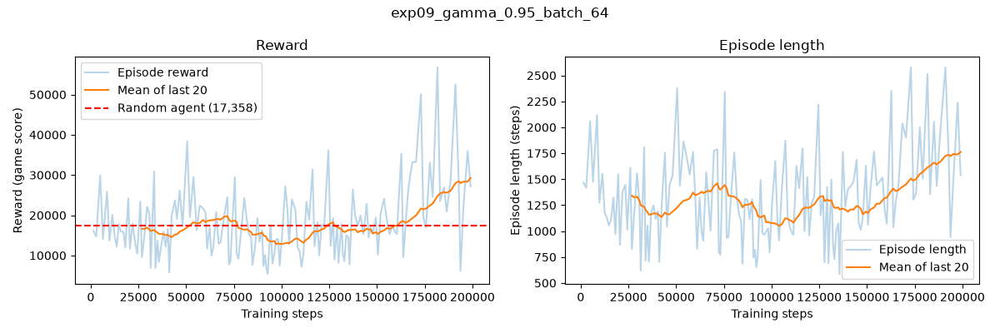
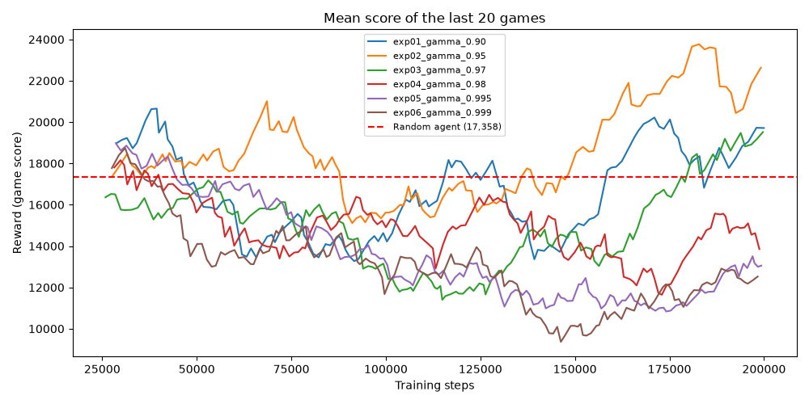
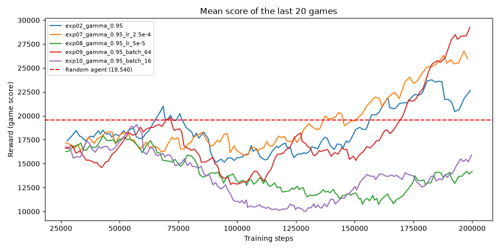

# Hyperparameter experiments: Jean Muhire

**Member name:** Jean Muhire
**My part:** the training script (`train.py`), and experiments on gamma, then learning rate and batch size at my best gamma.

## How every run was set up

To make the runs fair to compare, only the settings in the table change. Everything else stays the same:

- 200,000 steps per run, with the same random starting point (seed 42)
- The agent learns after every step, from a replay buffer that holds the last 100,000 experiences
- Learning starts after 10,000 warm-up steps, once the buffer has enough experiences to learn from
- The target network is updated every 1,000 steps
- For learning, every reward is turned into -1, 0 or +1, so big and small hits count the same. The scores we report are the real game scores.
- Epsilon starts at 1.0, ends at 0.05, and gets there in a straight line over the first 100,000 steps

**Score** is the mean real game score of the last 20 games of training, which is the score our team agreed to compare runs with. For reference, a player pressing random buttons averaged 17,358 over 50 seeded games in the notebook's random-agent test, and the plots draw that score as the red line. The team baseline (learning rate 1e-4, gamma 0.99, batch 32, same epsilon settings) scored 13,205 in Sheilla's baseline run (her experiment 1).

**Why I did not change epsilon:** our team split the six settings between us. I tested gamma, then learning rate and batch size. Bianca tests the three epsilon settings. Keeping epsilon the same in all my runs means any change in score comes from the setting I changed.

Each run's model and its full training log are in `models/JeanMuhire/`, in the folder with the same experiment number. To repeat a run, use the same settings as its row, for example experiment 9:

```bash
python train.py --gamma 0.95 --batch-size 64 --output-dir models/JeanMuhire/exp09_gamma_0.95_batch_64
```

## Results

| Experiment | Learning rate | Gamma | Batch size | Epsilon start | Epsilon end | Epsilon decay | Score | Observed behaviour |
|---|---|---|---|---|---|---|---|---|
| 1 | 1e-4 | 0.90 | 32 | 1.0 | 0.05 | 100,000 steps | 19,710 | The score dropped once random moves were reduced, then came back in the last quarter, ending a little above random play. It learned something, but caring this little about the future seems to hold it back. |
| 2 | 1e-4 | 0.95 | 32 | 1.0 | 0.05 | 100,000 steps | 22,630 | Steady for most of the run, then a clear rise in the last quarter, so it was still improving when training stopped. Best of my gamma values and above random play. |
| 3 | 1e-4 | 0.97 | 32 | 1.0 | 0.05 | 100,000 steps | 19,515 | Dipped in the middle, then recovered and reached its best score right at the end. It ends a little above random play in training, but played much better with no random moves at all, so it may simply need more steps. |
| 4 | 1e-4 | 0.98 | 32 | 1.0 | 0.05 | 100,000 steps | 13,855 | Its best moment was near the start, when it was still pressing mostly random buttons. Once it relied on its own choices, the score kept falling and games got shorter. |
| 5 | 1e-4 | 0.995 | 32 | 1.0 | 0.05 | 100,000 steps | 13,055 | The same pattern as gamma 0.98: best near the start, then a steady drop it never recovered from. Caring almost as much about the far future as the present made learning worse. |
| 6 | 1e-4 | 0.999 | 32 | 1.0 | 0.05 | 100,000 steps | 12,525 | My worst run. The score fell through the whole run and stayed low. With gamma this close to 1, the agent tries to count rewards far into the future, and those are hard to predict. Its guesses become unreliable, so it learns from bad answers. |
| 7 | 2.5e-4 | 0.95 | 32 | 1.0 | 0.05 | 100,000 steps | 25,970 | A faster learning rate on top of gamma 0.95. Its score rose through the second half and was still going up at the end. Bigger corrections helped it improve more in the same number of steps, with no sign of becoming unstable. |
| 8 | 5e-5 | 0.95 | 32 | 1.0 | 0.05 | 100,000 steps | 14,205 | A slower learning rate. It fell after the warm-up and only slightly recovered. With corrections this small, 200,000 steps were not enough for it to learn a good strategy. |
| 9 | 1e-4 | 0.95 | 64 | 1.0 | 0.05 | 100,000 steps | **29,245** | **My best run.** A bigger batch gave steadier lessons. It held level for most of the run, then climbed fast in the last quarter, and reached its highest score at the very end. It also had the longest games, so it survived longer. |
| 10 | 1e-4 | 0.95 | 16 | 1.0 | 0.05 | 100,000 steps | 15,900 | A smaller batch. The score dropped a lot in the middle and recovered only a little. Learning from only 16 experiences at a time made each lesson noisy, so it went in the wrong direction more often. |

## My best run in detail (experiment 9)

The assignment asks for episode length, number of steps and rewards for the best experiment. These come from `models/JeanMuhire/exp09_gamma_0.95_batch_64/training_log.csv`.

| Measure | Value |
|---|---|
| Steps trained | 200,000 (the last finished game ended at step 199,022) |
| Games played during training | 149 |
| Mean game length, last 20 games | 1,763 steps |
| Mean score, last 20 games | 29,245 |
| Best single game | 56,800 |
| Mean score with no random moves (5 test games) | 28,260, ranging from 17,000 to 47,700 |

## Training plots

Made with `plot_training.py` from each run's training log. All plots are in `training_plots/JeanMuhire/` at the top of the repo.

**My best run (experiment 9):** the score stayed below the random agent for most of the run, then climbed past it after about 160,000 steps and was still rising at the end. Games got longer at the same time, so the agent survived longer.



**Gamma experiments (1 to 6):** gamma 0.95 pulls ahead in the second half. Every gamma of 0.98 and above sinks and stays low.



**Learning rate and batch size at gamma 0.95 (experiments 2 and 7 to 10):** batch 64 and learning rate 2.5e-4 climb the most at the end. Learning rate 5e-5 and batch 16 fall in the middle and stay low.



Each experiment also has its own plot in the same folder, named like its model folder.

## What I found

**Best:** experiment 9 (gamma 0.95, learning rate 1e-4, batch 64), score 29,245.
**Worst:** experiment 6 (gamma 0.999), score 12,525.

**What helped**

- **Gamma around 0.95.** It worked best among my gamma values, and every gamma of 0.98 and above stayed between about 12,000 and 14,000. In Atlantis, a shot pays off quickly, so the agent does not need to plan very far ahead. Looking too far ahead made its guesses less reliable.
- **A bigger batch (64).** Steadier lessons led to the best result.
- **A faster learning rate (2.5e-4).** This gave the second-best result.

**What hurt**

- **Gamma close to 1** (0.98, 0.995, 0.999).
- **A slow learning rate (5e-5)**, which learned too slowly to get anywhere in 200,000 steps.
- **A small batch (16)**, which made each lesson too noisy.

**A pattern across the runs:** in almost every run, the score dipped in the middle, as epsilon went down and the agent started relying on its own choices instead of random buttons. The good runs recovered and were still rising at the end. The weak runs never recovered. This suggests the good settings would improve further with more steps.

**My final choice:** gamma 0.95, learning rate 1e-4, batch 64. It had the highest score, it was still improving at the end, and it also played well with no random moves at all. Experiment 7 suggests a faster learning rate could help too, so learning rate 2.5e-4 with batch 64 is worth testing in the team's final, longer run.

**Limits:** each setting was run once with one seed, so small differences between runs may be luck. The large gaps, such as gamma 0.95 against 0.99 and above, are much more likely to be real.
